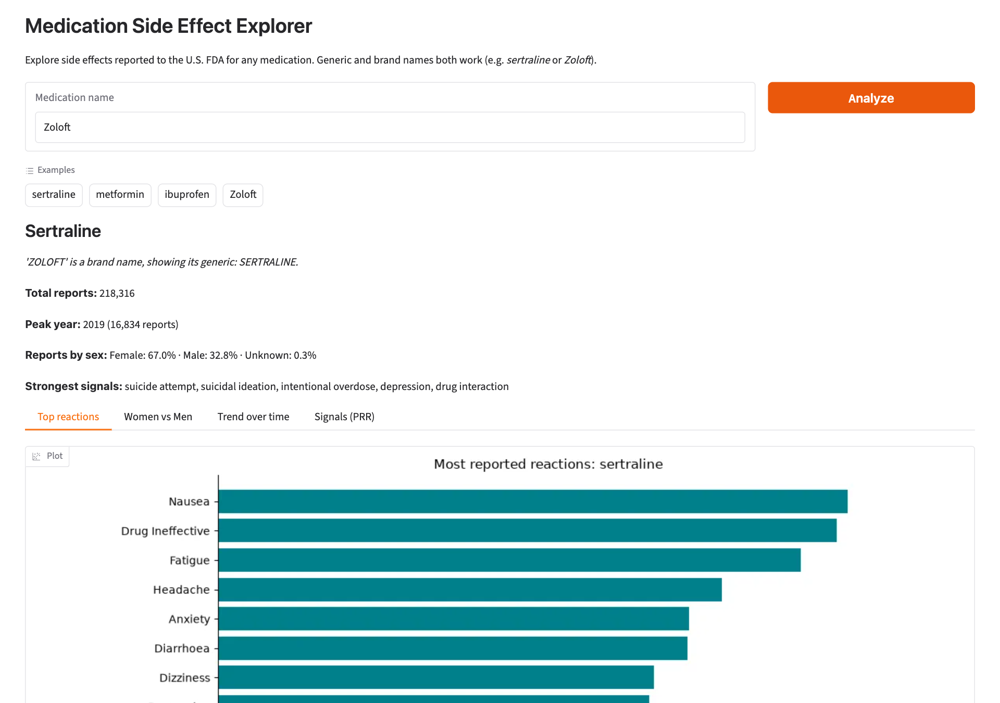
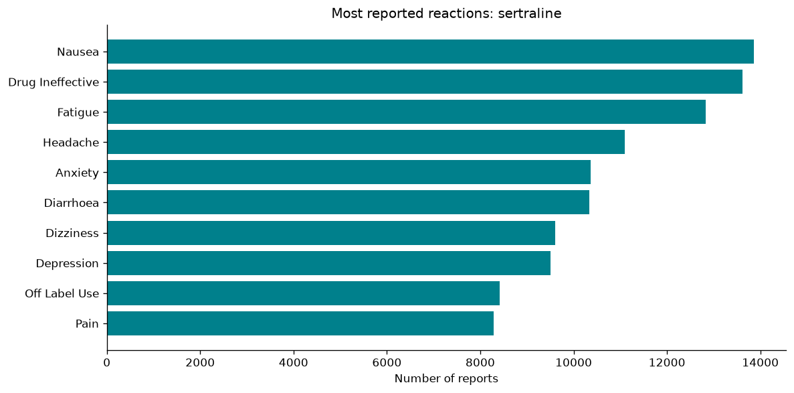
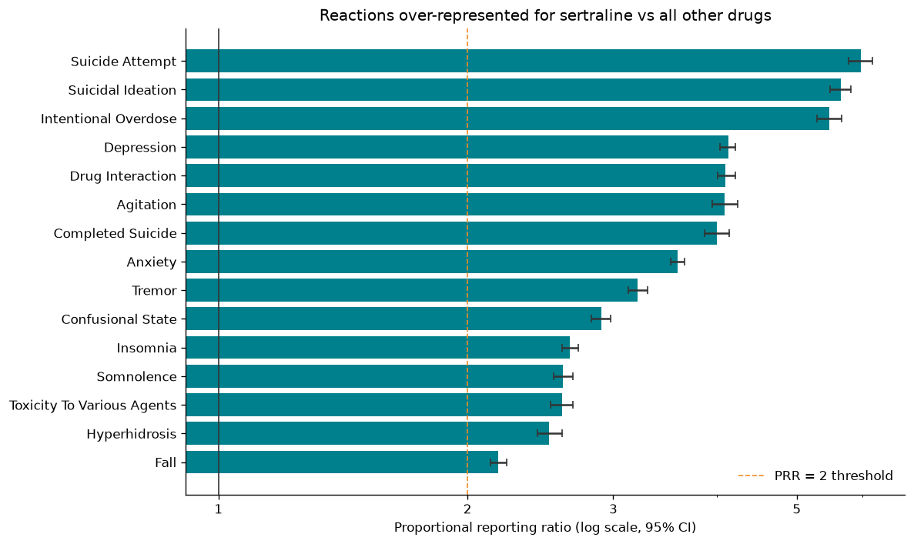
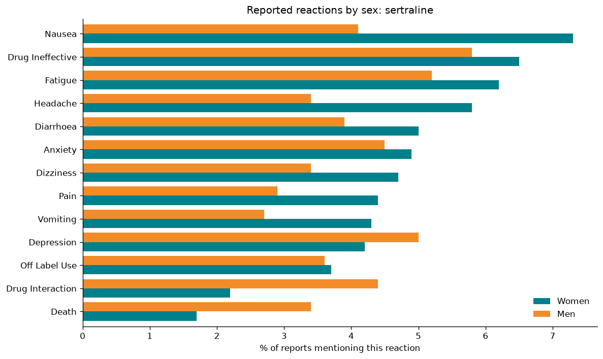
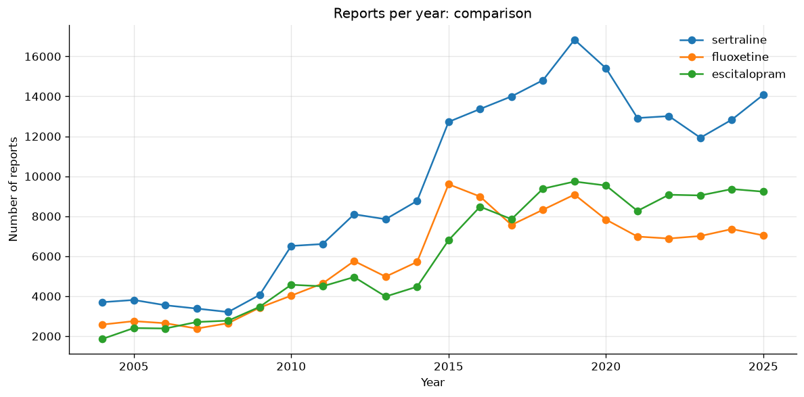

# Medication Side Effect Explorer

[](https://github.com/sankara226/MEDICATION-SIDE-EFFECT-EXPLORER/actions/workflows/tests.yml)


**Live demo:** [huggingface.co/spaces/sankara226/medication-side-effect-explorer](https://huggingface.co/spaces/sankara226/medication-side-effect-explorer)

**Type a medication, see what people reported to the U.S. FDA after taking it.** The project explores about
20 million adverse event reports from the FDA Adverse Event Reporting System (FAERS) through the free
[openFDA API](https://open.fda.gov/apis/drug/event/). It ships as an analysis notebook, a small Python package and a web app.

> A report means someone took a drug and later had a reaction. It does **not** prove the drug caused it.
> Educational project, **not medical advice**.



## Goal

Make FDA safety data readable for a non-specialist and answer four questions for any drug:

1. Which reactions are reported most often?
2. Do women's and men's reports differ?
3. How has reporting changed over time?
4. Which reactions are **specific** to this drug rather than reported for every drug?

The fourth question turned out to matter most (see [Key findings](#key-findings)).

## Key findings

Case study: **sertraline** (Zoloft), 218,316 reports. Data last updated by openFDA on 2026-07-30.

**1. Raw counts mostly show what everyone reports.** Sertraline's top reactions (nausea, *drug ineffective*, fatigue,
headache) look like the top of almost any drug's list.



**2. Disproportionality analysis finds the real signal.** The proportional reporting ratio (PRR) compares the share of
a drug's reports mentioning a reaction with the same share for all other drugs. Ranked by PRR, the top of the list is
**suicide attempt (PRR 6.0), suicidal ideation (5.7), agitation and tremor**, which matches the known SSRI safety
profile and the FDA boxed warning on suicidality. *Drug ineffective* falls to a PRR of about 1.0.



**3. The method passes a sanity check.** On **metformin**, with no hint given, the top signal is **lactic acidosis
(PRR of about 73)**, the drug's boxed warning.

**4. Women vs men: compare proportions, not counts.** 67% of sertraline reports concern women, who are also
prescribed antidepressants more often. Within each sex, women's reports mention nausea and headache more often,
and men's mention *drug interaction* (4.4% vs 2.2%) and *death* (3.4% vs 1.7%) more often.



**5. Reporting rose sharply after 2014 and peaked in 2019** (16,834 reports) for sertraline, a pattern shared with
fluoxetine and escitalopram. This reflects reporting behaviour more than safety: openFDA has no prescription
volumes to normalise by.



## How it works

1. **Find the drug.** The input is cleaned, brand names are converted to generics (Zoloft to sertraline),
   salt suffixes are stripped and typos get suggestions from `difflib`.
2. **Query openFDA.** Each analysis is a `count` query, aggregated on the server. A new drug costs about
   10 requests, and repeated searches come from an in-memory cache.
3. **Analyse.** Top reactions, women vs men, reports per year and PRR signals.
4. **Display.** Matplotlib charts shared by the notebook and the Gradio app.

### The PRR in one table

|                     | reaction R | other reactions |
|---------------------|-----------:|----------------:|
| **drug D**          | a          | b               |
| **all other drugs** | c          | d               |

`PRR = [a / (a+b)] / [c / (c+d)]`, with a 95% confidence interval on the log scale. A reaction is flagged when
PRR >= 2, the interval's lower bound is above 1 and there are at least 3 reports, a common screening rule in
pharmacovigilance. All four cells come from openFDA counts: one cached query for database-wide reaction totals, plus
individual lookups for rarer terms.

## What worked, what didn't

**Worked**
- openFDA `count` queries do the aggregation on the server, so each chart needs one small request and no bulk download.
- Forgiving search: brand names (*Zoloft* finds sertraline, *Tylenol* finds acetaminophen) and typo suggestions (*ibuprofin* suggests ibuprofen).
- The PRR recovered known warnings for two unrelated drugs without being told what to look for.
- The `(result, error)` pattern: empty input, unknown drugs, timeouts and rate limits all produce a friendly message.

**Didn't work at first, and how it was fixed**

| Problem | Effect | Fix |
|---|---|---|
| Typo `yealy` in the current-year filter | Every trend ended in a fake drop (incomplete year) | Corrected, and covered by a test |
| Function body indented inside its `if error:` branch | Yearly trend never returned data | Re-indented, plus a test |
| Colab-only lines (`!pip`, an auto-added import) | Script failed outside Colab | Removed, `requirements.txt` added |
| Women/men tables merged on each sex's top 10 | Blank bars when a reaction was 11th for one sex | Values looked up in a top-100 list |
| Brand lookup returned `SERTRALINE HYDROCHLORIDE` | Exact phrase missed about half the reports | Salt suffixes stripped |
| `count_reports` returned 0 on any error | A network failure looked like "drug not found" | HTTP 404 means zero; other errors are reported |
| Stray openFDA records dated 1997 to 2003 | Flat line at zero before the data really starts | Trend starts in 2004 |
| Original script named `code.py` | Shadowed Python's built-in `code` module, so the test runner froze | Renamed |
| `count` limit 1,000 without an API key | openFDA rejects it (`API_KEY_MISSING`) | Limit set to 500 unless a key is present |

**Data-quality surprises**
- One molecule appears under many names: `SERTRALINE` and `SERTRALINE HYDROCHLORIDE`, and ibuprofen appears under 12 names in the catalog,
  including the misspelling **`IBUPFROFEN`**, which comes from a product label in openFDA's own data.
- Reactions use MedDRA terms with British spelling (*diarrhoea*, *dyspnoea*).

## Limitations

- **Reports aren't causation**, and there is no denominator (number of people taking the drug).
- `generic_name` matches every drug listed in a report, including ones taken alongside it, not only the suspected one.
- FAERS includes duplicate reports, under-reporting and reporting surges driven by lawsuits or news coverage.
- The PRR is a screening tool. Real pharmacovigilance adds deduplication, Bayesian shrinkage (e.g. EBGM) and clinical review.
- Without an API key, openFDA allows 1,000 requests per day per IP.

## Next steps

- Restrict to *suspect* drugs (`drugcharacterization = 1`) by downloading raw reports instead of using `count`.
- Filter by age group and serious outcomes (death, hospitalisation).
- Normalise trends with prescription volumes (e.g. Medicare Part D).

## Run it

```bash
git clone https://github.com/sankara226/MEDICATION-SIDE-EFFECT-EXPLORER.git
cd MEDICATION-SIDE-EFFECT-EXPLORER
python -m venv .venv && source .venv/bin/activate     # Windows: .venv\Scripts\activate
pip install -r requirements-dev.txt

python app.py                                         # web app at http://127.0.0.1:7860
jupyter notebook notebooks/medication_side_effect_explorer.ipynb
pytest                                                # 29 offline tests, openFDA is mocked
```

Optional: a free [openFDA API key](https://open.fda.gov/apis/authentication/) raises the daily limit from 1,000 to
120,000 requests. Copy `.env.example` to `.env` and paste the key after `OPENFDA_API_KEY=`. The `.env` file is
ignored by git, so the key stays on your machine.

**Deploy:** the app is ready for Hugging Face Spaces, see [`deploy/README.md`](deploy/README.md).

## Project structure

| Path | Content |
|---|---|
| `app.py` | Gradio web app |
| `med_explorer/api.py` | openFDA client: errors, cache, API key |
| `med_explorer/analysis.py` | Name resolution, reactions, sex comparison, trends, PRR |
| `med_explorer/charts.py` | Matplotlib figures |
| `notebooks/` | Full analysis with outputs |
| `tests/` | Offline test suite (fake openFDA server) |
| `original/` | First version, written step by step in Colab |
| `assets/` | Charts and screenshot used in this README |
| `deploy/` | Step-by-step Hugging Face Spaces deployment |
| `.github/workflows/` | CI: runs the tests on every push |

## Data and license

Data: [openFDA](https://open.fda.gov/) drug adverse event endpoint (FAERS), public domain, provided by the U.S. FDA.
openFDA's disclaimer applies: *do not rely on openFDA to make decisions regarding medical care.*

Code released under the [MIT License](LICENSE).
